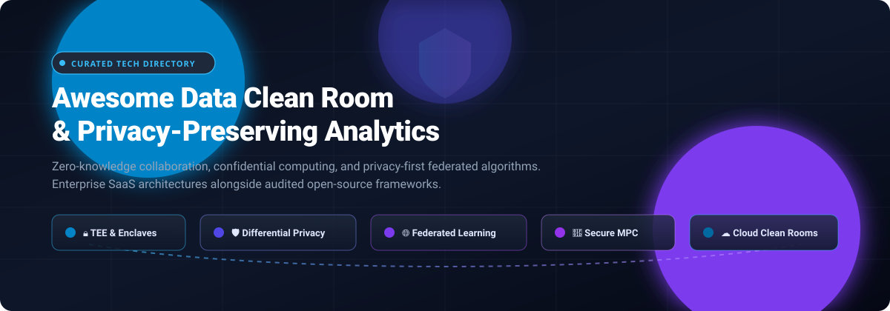

# 🛡️ Awesome Data Clean Room & Privacy-Preserving Analytics

<p align="center">
  
</p>

<p align="center">
  <a href="https://github.com/ishandutta2007/Awesome-Awesome-Awesome"></a>
  <a href="https://discord.gg/jc4xtF58Ve"></a>
  <a href="https://github.com/ishandutta2007/Awesome-Awesome-Awesome"></a>
  <a href="https://github.com/ishandutta2007/Awesome-Data-Clean-Room-Privacy-Preserving-Analytics/stargazers"></a>
  <a href="https://github.com/ishandutta2007/Awesome-Data-Clean-Room-Privacy-Preserving-Analytics/network/members"></a>
  <a href="https://github.com/ishandutta2007/Awesome-Data-Clean-Room-Privacy-Preserving-Analytics/blob/main/LICENSE"></a>
  <a href="https://github.com/ishandutta2007"></a>
</p>

> 🚀 **A curated directory of enterprise SaaS Data Clean Rooms (DCR) and open-source Privacy-Preserving Analytics (PPA) frameworks** — covering Trusted Execution Environments (TEEs), Confidential Computing, Differential Privacy, Federated Learning, and Multi-Party Computation (MPC).

---

## 📑 Table of Contents

- [📊 Sector Overview & Market Dynamics](#-sector-overview--market-dynamics)
- [🏢 Enterprise SaaS & Hosted Platforms](#-enterprise-saas--hosted-platforms)
- [💻 Open-Source GitHub Projects](#-open-source-github-projects)
- [🏗️ Architecture & Platform Taxonomy](#️-architecture--platform-taxonomy)
- [🤝 How to Contribute](#-how-to-contribute)
- [⭐ Star History](#-star-history)
- [💖 Support & Sponsorship](#-support--sponsorship)
- [⚠️ Disclaimer](#️-disclaimer)

---

## 📊 Sector Overview & Market Dynamics

The global Data Clean Room (DCR) and privacy-preserving collaboration market is valued at approximately **$4.0B to $4.3B in 2026** (up from ~$3.2B in 2025) and is projected to expand to **$12.1B–$14.7B by 2030**, reflecting a compound annual growth rate (CAGR) of **19.5% to 26%**. 📈

The sector exhibits **moderate-to-high concentration among foundational cloud hyperscalers and data platforms** (AWS Clean Rooms, Google Ads Data Hub, Snowflake), while remaining **moderately fragmented across independent and vertical application layers** (confidential computing, retail media networks, and decentralized cross-cloud identity graphs). Major consolidation events—such as LiveRamp's acquisition of Habu ($200M) and its pending buyout by Publicis ($2.5B), Snowflake's acquisition of Samooha, and WPP's acquisition of InfoSum—demonstrate a steady trend toward end-to-end bundled data infrastructure. 🌐

---

## 🏢 Enterprise SaaS & Hosted Platforms

The table below outlines key commercial Data Clean Room platforms, sorted by **Company Size / Scale** (valuation or market cap descending). 🔍

| Platform / Vendor | Company Size / Scale (Desc) | Pricing & Starting Cost | Free Tier & Free Trial Limits | Key Architecture & Best For |
| :--- | :--- | :--- | :--- | :--- |
| **[Google Ads Data Hub](https://adsdatahub.google.com/)** | **~$2.1T Market Cap** (Alphabet) | **$0 base license fee**; billed via Google Cloud BigQuery compute/storage ($6.25/TB on-demand query scan) | **Free Sandbox environment** with synthetic mock campaign data for SQL query authoring and schema verification; 1 TiB/mo free BigQuery analysis | Walled-garden media clean room; best for large brands analyzing cross-network Google Ads, DV360, and YouTube campaign lift. |
| **[AWS Clean Rooms](https://aws.amazon.com/clean-rooms/)** | **~$2.0T Market Cap** (Amazon) | **$2.00 per CRPU-hour** (US East, per-second billing, 60s minimum); **$4.00/CRPU-hr** with Differential Privacy; PySpark jobs have 10-min minimum | **No free tier for Clean Rooms ML**; standard AWS 12-month free tier covers core storage (S3 5 GB) but all CRPU computation incurs standard hourly fees | Cloud-native multi-party collaboration; best for AWS-centric data lakes seeking zero data movement and automated cryptographic compute isolation. |
| **[Snowflake Data Clean Rooms](https://www.snowflake.com/en/data-cloud/workloads/collaboration/data-clean-rooms/)** | **~$110B Market Cap** / $4.68B FY26 Rev (NYSE: SNOW) | **$0 additional SaaS license fee**; consumption-based credit model starting at standard Snowflake editions (~$2.00 to $4.00 per warehouse credit-hour) | **30-day free trial with $400 in free credits** (full Snowflake ecosystem & native apps enabled) | Snowflake Native App framework (formerly Samooha); best for Snowflake-hosted enterprises running governed multi-party joins without external data replication. |
| **[Epsilon Clean Room](https://www.epsilon.com/emea/products-and-services/clean-room)** | **$4.4B Acquisition Price** (Publicis Groupe) | **Custom annual contract quote**; enterprise private offers via AWS Marketplace typically start at **$50,000+/year** base commitment | **No free tier and no self-serve free trial**; evaluations require sales discovery and guided tenant onboarding | Identity-enriched clean room; best for brands requiring instant pre-loaded demographic and transactional graphs (46M+ unique consumer profiles). |
| **[LiveRamp Safe Haven / Habu](https://www.liveramp.com/)** | **$2.5B Valuation** ($813M FY26 Rev, acquired by Publicis) | **Custom annual subscription quote**; baseline multi-cloud enterprise deployments typically start around **$30,000 to $50,000/year** | **No free tier and no public free trial**; proof-of-concept (PoC) scopes require enterprise sales agreements | Interoperable cross-cloud collaboration layer; best for omnichannel marketers connecting fragmented data silos across AWS, Azure, Snowflake, and Databricks. |
| **[InfoSum](https://www.infosum.com/)** | **$300M Valuation** (Acquired by WPP; $93M+ venture funding) | **Custom enterprise license quote**; annual private software contracts typically range from **$50,000 to $150,000+/year** based on bunker nodes | **No free tier, no freemium plan, and no public free trial**; evaluation conducted strictly via sales-guided architectural validation | Decentralized "non-movement of data" bunker network; best for organizations demanding absolute mathematical data residency and zero cross-party matching keys. |
| **[Optable](https://optable.co/)** | **$100M–$250M Valuation** ($20M Series A Acceleration round) | **Custom annual SaaS quote**; flat-rate infrastructure subscription based on identity volume with 0% take-rate on direct marketplace transactions | **No free tier and no self-serve free trial**; private sandbox sandpits provided solely under commercial evaluation pilots | Edge-computing clean room and identity resolution suite; best for media publishers and ad networks activating first-party audiences with sub-5s latency. |
| **[Decentriq](https://www.decentriq.com/)** | **$50M–$100M Valuation** ($25M total funding raised) | **Custom enterprise subscription quote**; typical confidential computing tenant deployments start at **$48,000 to $50,000+/year** | **No free tier and no public free trial**; live sandbox demos and security audits provisioned upon enterprise technical review | Hardware-enforced confidential computing clean room (Intel SGX / AMD SEV); best for healthcare, banking, and data consortia requiring hardware-level encryption. |

---

## 💻 Open-Source GitHub Projects

Curated list of open-source data clean room engines, confidential computing runtimes, federated learning frameworks, and differential privacy libraries. 🌟

Repositories are sorted by **GitHub Stars (Descending)**.

| Project / Repository | GitHub Stars (Desc) | Technology & Ecosystem | Primary Architecture & Description |
| :--- | :---: | :--- | :--- |
| **[OpenMined/PySyft](https://github.com/OpenMined/PySyft)** | [](https://github.com/OpenMined/PySyft/stargazers) | Python, Domain Networks | 🧠 Federated data governance framework enabling data scientists to query remote, protected datasets using Differential Privacy and secure remote computation without seeing raw records. |
| **[flwrlabs/flower](https://github.com/flwrlabs/flower)** | [](https://github.com/flwrlabs/flower/stargazers) | Python, C++, Mobile/Edge | 🌸 Unified federated AI and analytics framework designed to scale privacy-preserving model training and compute workloads across millions of distributed edge clients and multi-tenant data silos. |
| **[FederatedAI/FATE](https://github.com/FederatedAI/FATE)** | [](https://github.com/FederatedAI/FATE/stargazers) | Python, C++, Java | 🏛️ Industrial-grade federated learning platform implementing secure multi-party computation (MPC), homomorphic encryption, and federated feature engineering for enterprise banking and cross-silo analytics. |
| **[FedML-AI/FedML](https://github.com/FedML-AI/FedML)** | [](https://github.com/FedML-AI/FedML/stargazers) | Python, PyTorch | ⚡ Open platform and cross-cloud scheduler for distributed machine learning and federated training across decentralized nodes and heterogeneous hardware accelerators. |
| **[google/differential-privacy](https://github.com/google/differential-privacy)** | [](https://github.com/google/differential-privacy/stargazers) | C++, Go, Java | 🔬 Production-tested differential privacy libraries powering Google Ads Data Hub and internal analytics; includes Laplace/Gaussian noise mechanisms, DP SQL query building, and stochastic accounting. |
| **[secretflow/secretflow](https://github.com/secretflow/secretflow)** | [](https://github.com/secretflow/secretflow/stargazers) | Python, C++ | 🌊 Comprehensive privacy-preserving computing framework integrating Secure Multi-Party Computation (PPU), Homomorphic Encryption (HE), Trusted Execution Environments (TEEs), and Differential Privacy. |
| **[meta-pytorch/opacus](https://github.com/meta-pytorch/opacus)** | [](https://github.com/meta-pytorch/opacus/stargazers) | Python, PyTorch | 🛡️ High-speed library for training PyTorch models with Differential Privacy (DP-SGD), enabling private model training with strict mathematical epsilon guarantees and minimal performance overhead. |
| **[enarx/enarx](https://github.com/enarx/enarx)** | [](https://github.com/enarx/enarx/stargazers) | Rust, WebAssembly | 🔐 Application deployment runtime for Confidential Computing enclaves (Intel SGX, AMD SEV) utilizing WebAssembly to isolate untrusted infrastructure from sensitive multi-party analytical workloads. |
| **[tf-encrypted/tf-encrypted](https://github.com/tf-encrypted/tf-encrypted)** | [](https://github.com/tf-encrypted/tf-encrypted/stargazers) | Python, TensorFlow | 🔒 Framework for privacy-preserving machine learning in TensorFlow, executing secure multi-party computation (MPC) and encrypted tensor operations across multiple un-trusted participants. |
| **[data61/MP-SPDZ](https://github.com/data61/MP-SPDZ)** | [](https://github.com/data61/MP-SPDZ/stargazers) | C++, Python | 🧮 Versatile benchmarking and deployment library for multi-party computation protocols (SPDZ, MASCOT, Semi2k), allowing private multiparty aggregation and secure table joins. |
| **[IBM/differential-privacy-library](https://github.com/IBM/differential-privacy-library)** | [](https://github.com/IBM/differential-privacy-library/stargazers) | Python | 📊 Diffprivlib is a general-purpose Python library for differential privacy, offering DP-compliant Scikit-Learn estimators, machine learning models, and privacy budget management. |
| **[apache/teaclave](https://github.com/apache/teaclave)** | [](https://github.com/apache/teaclave/stargazers) | Rust, Intel SGX | ☕ Apache universal secure computing platform providing a confidential computing FaaS engine to securely execute multi-party data processing inside hardware enclaves. |
| **[gramineproject/gramine](https://github.com/gramineproject/gramine)** | [](https://github.com/gramineproject/gramine/stargazers) | C, Rust | 🛡️ Lightweight LibOS tailored for Intel SGX and TDX enclaves, allowing unmodified Linux applications and database engines to run securely inside hardware confidential computing partitions. |
| **[edgelesssys/ego](https://github.com/edgelesssys/ego)** | [](https://github.com/edgelesssys/ego/stargazers) | Go, C | 🚀 Open-source SDK to build, verify, and run confidential applications in Go inside hardware enclaves with automated attestation and end-to-end payload encryption. |
| **[OpenMined/PyDP](https://github.com/OpenMined/PyDP)** | [](https://github.com/OpenMined/PyDP/stargazers) | Python, C++ | 🐍 Python bindings for Google's differential privacy C++ library, providing simplified statistical primitives (mean, median, variance, quantile) with rigorous DP noise injection. |
| **[opendp/opendp](https://github.com/opendp/opendp)** | [](https://github.com/opendp/opendp/stargazers) | Rust, Python | 📐 Community differential privacy platform organized by Harvard Privacy Tools Project, providing mathematically vetted building blocks for differential privacy measurement and privacy budgets. |
| **[tiktok-privacy-innovation/PrivacyGo-DataCleanRoom](https://github.com/tiktok-privacy-innovation/PrivacyGo-DataCleanRoom)** | [](https://github.com/tiktok-privacy-innovation/PrivacyGo-DataCleanRoom/stargazers) | Go, C++, GCP | 🛡️ End-to-end TEE-based open-source Data Clean Room framework open-sourced by TikTok; features a two-stage Programming/Execution architecture, JWT attestation verification, and isolated confidential VMs. |
| **[Penncil/pda](https://github.com/Penncil/pda)** | [](https://github.com/Penncil/pda/stargazers) | R, C++ | 🏥 Privacy-Preserving Distributed Algorithms for multi-site healthcare and biostatistics; computes lossless federated generalized linear models and survival curves by transferring only summary gradients. |
| **[aws-solutions/data-connectors-for-aws-clean-rooms](https://github.com/aws-solutions/data-connectors-for-aws-clean-rooms)** | [](https://github.com/aws-solutions/data-connectors-for-aws-clean-rooms/stargazers) | Python, CDK, AWS | 🔗 Reference architecture and pre-built connectors to automate ingestion, schema normalization, and cryptographic hashing into AWS Clean Rooms from diverse CRM and marketing sources. |

---

## 🏗️ Architecture & Platform Taxonomy

Understanding the technical boundaries of Data Clean Rooms prevents vendor misalignment:

```
┌─────────────────────────────────────────────────────────────────────────────┐
│                          DATA CLEAN ROOM ARCHITECTURES                      │
├─────────────────────┬──────────────────────┬────────────────────────────────┤
│ Native Cloud DCRs   │ Decentralized Nodes  │ TEE Confidential Enclaves      │
│ (Snowflake, AWS)    │ (InfoSum)            │ (PrivacyGo, Decentriq)         │
├─────────────────────┼──────────────────────┼────────────────────────────────┤
│ • Compute moved to  │ • Zero data movement │ • Hardware isolation           │
│   central storage   │ • Bunkers store math │   (Intel SGX / AMD SEV)        │
│ • SQL access policy │   signatures only    │ • Remote attestation           │
│ • Consumption-based │ • Private contracts  │ • Complete crypto security     │
└─────────────────────┴──────────────────────┴────────────────────────────────┘
```

1. **☁️ Managed Cloud Clean Rooms (Snowflake, AWS, Google ADH):**
   - Provide turnkey identity resolution, managed SQL governance, and direct linkage to first-party cloud data warehouses.
   - Ideal for production campaigns and cross-partner audience activation, but bill via ongoing compute consumption.
2. **🌐 Decentralized Data Collaboration (InfoSum, Optable):**
   - Eliminate central data centralization entirely. Partners hold data in isolated "bunkers" or local edge nodes; queries evaluate aggregate statistical overlap without sharing raw user IDs.
3. **🔒 Hardware Enclaves & TEEs (Decentriq, PrivacyGo, Teaclave):**
   - Execute analytical workloads inside cryptographic hardware enclaves (Intel SGX, AMD SEV). Memory is encrypted at runtime; untrusted cloud hosts and operators cannot inspect memory contents.
4. **🛡️ Federated Learning & Differential Privacy (PySyft, Flower, OpenDP, Google DP):**
   - Mathematical privacy models where models or statistical algorithms train locally at each edge node, returning aggregated gradient updates with added calibrated noise to mathematically prevent record re-identification.

---

## 🤝 How to Contribute

We welcome community contributions, open-source tool additions, and vendor pricing updates! 🙌

1. 🍴 Fork this repository.
2. 🌿 Create a new branch: `git checkout -b feature/add-new-dcr-platform`.
3. 📝 Update `README.md` following the established tabular format (include license, GitHub star badge, and explicit pricing/free-tier details).
4. 🚀 Commit your changes and open a Pull Request.

---

## 📈 Star History

[](https://star-history.dera.page/#ishandutta2007/Awesome-Data-Clean-Room-Privacy-Preserving-Analytics&type=date&legend=top-left)

---

## 💖 Support & Sponsorship

Thank you for exploring and utilizing this curated directory! If you found this resource helpful for your research, team, or organization, please consider supporting the project:

- ⭐ **Star this repository** to help others discover it on GitHub.
- 🍴 **Fork and contribute** new platforms, research frameworks, and price updates.
- 📢 **Share with colleagues** in data engineering, privacy tech, and marketing science communities.
- ☕ **Buy a coffee & sponsor the author:** Support ongoing curation and maintenance via the [GitHub Sponsor Dashboard](https://github.com/sponsors/ishandutta2007).

---

## ⚠️ Disclaimer

- 📌 This list is community-curated for informational and architectural evaluation purposes.
- ⚖️ Mention of specific commercial products or open-source repositories does not constitute legal endorsement or certification of compliance with GDPR, CCPA, HIPAA, or other data privacy regulations.
- 💳 Cloud compute costs, API licenses, and enterprise contract terms are subject to change by their respective providers. Always verify specific terms directly with vendor account teams.
